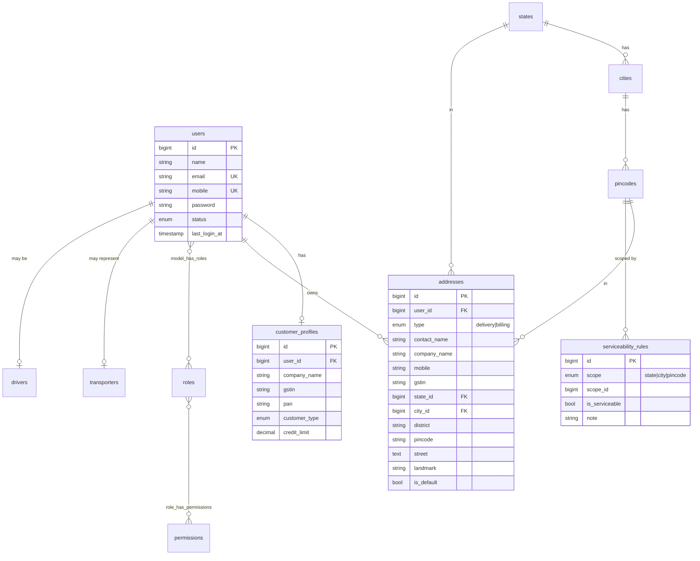
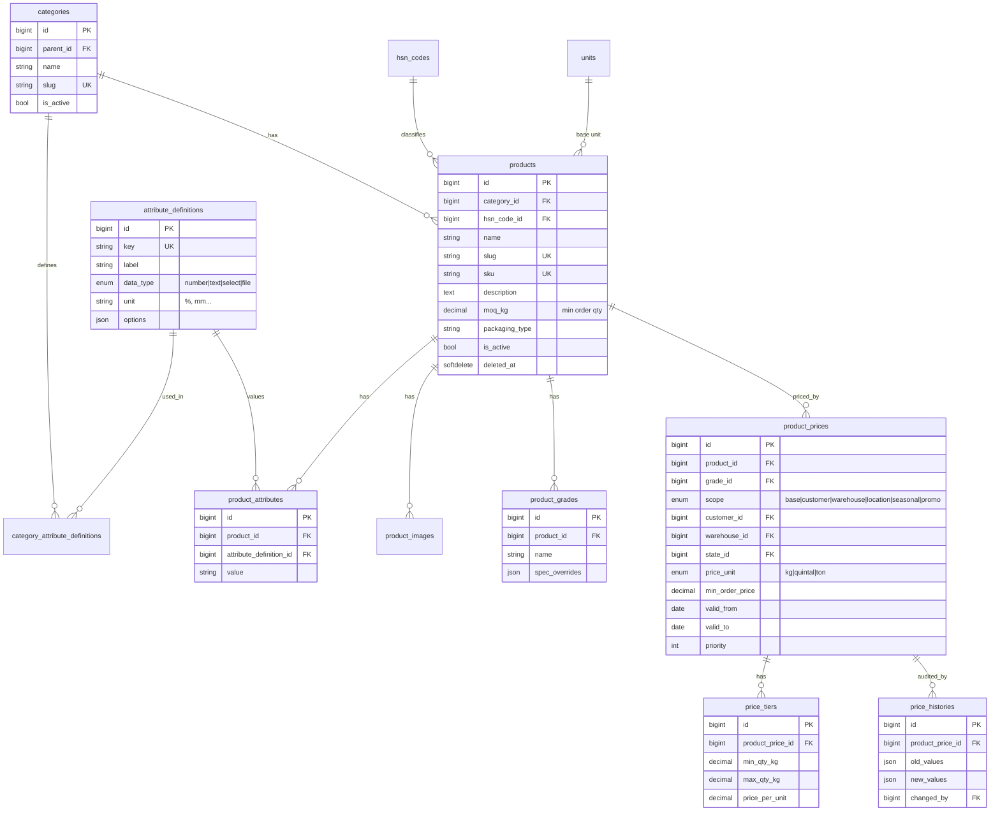
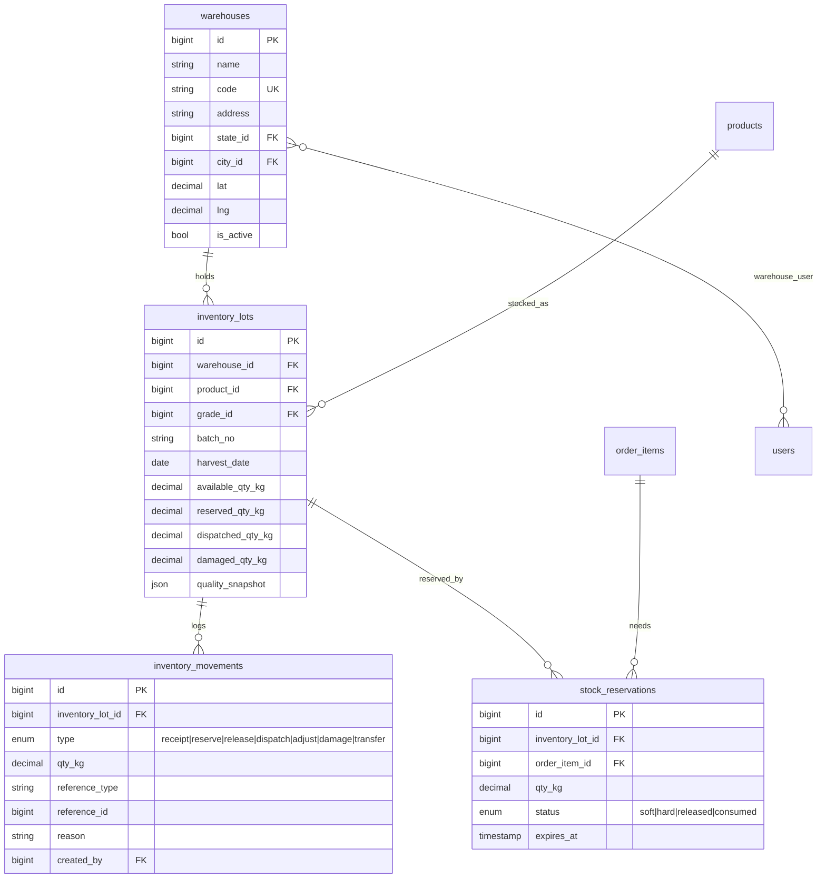
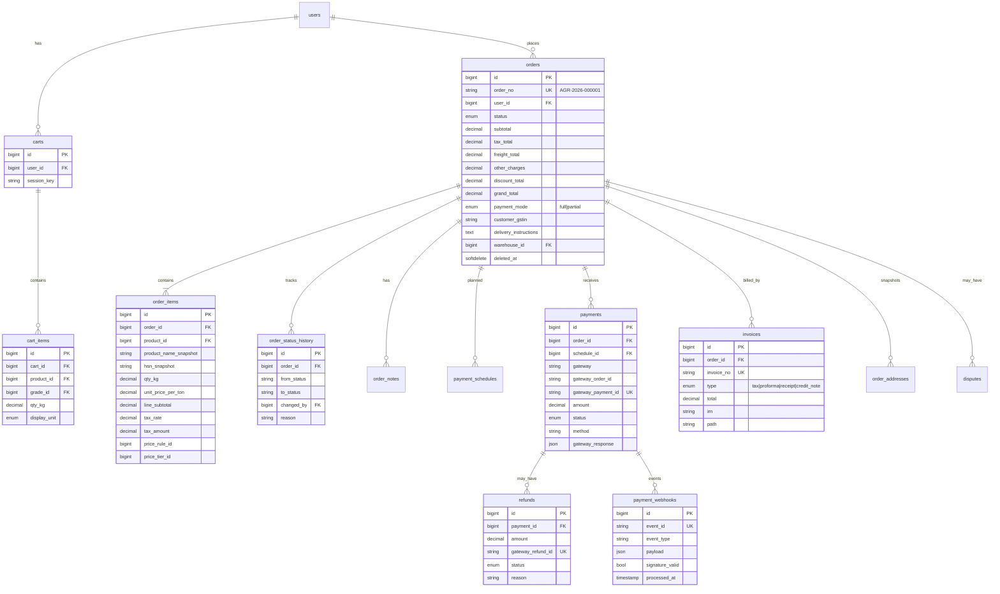
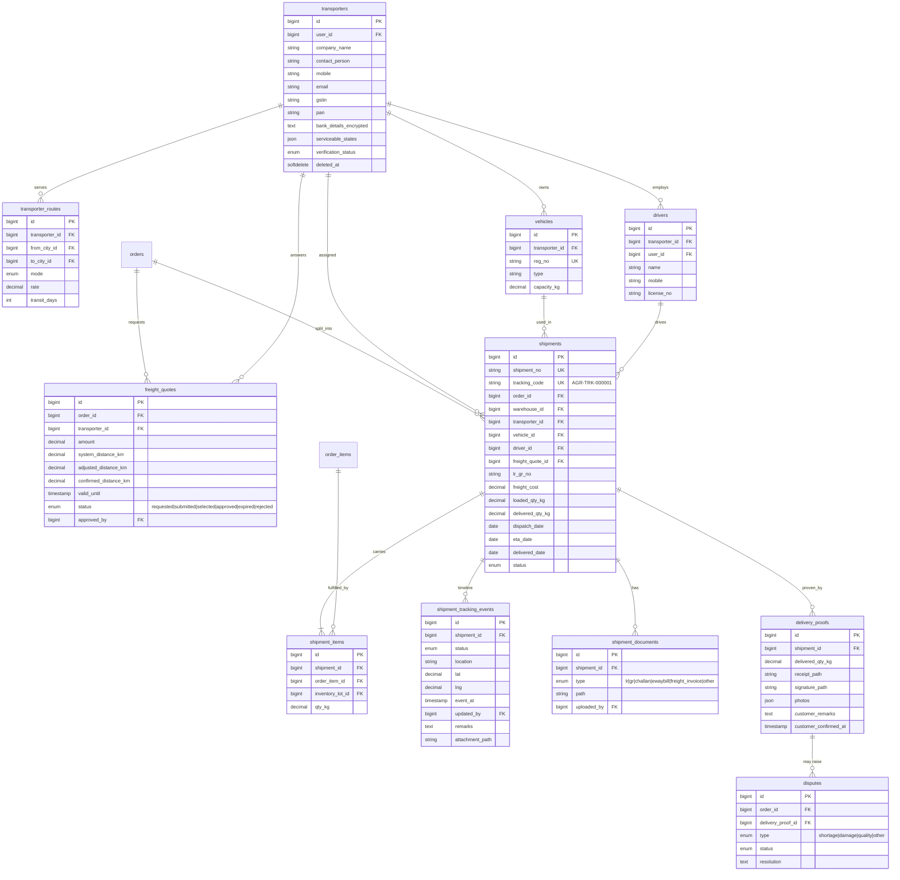

# AGRI TRADE – Phase 1: Architecture & Plan

Status: Phase 1 (analysis and design). No application code has been written. The working directory was empty, so this is a greenfield build.

---

## 0. Key decisions (please confirm)

| # | Decision | Choice | Why |
|---|----------|--------|-----|
| 1 | Architecture style | **Modular monolith** (one Laravel app, domain modules) | Microservices would add cost with no benefit at this scale. Modules keep the code separable later. |
| 2 | Versions | Latest stable Laravel + PHP 8.3+, MySQL 8, Filament (version matching the Laravel release), Inertia + Vue 3, Tailwind | **Verify exact compatible versions at install time (Phase 2).** I will not guess version numbers from memory. |
| 3 | UI split | **Filament** for Super Admin, Admin, Sales, Warehouse. **Inertia/Vue** for Customer, Transporter, Driver, and the public site. | Staff get data-heavy CRUD quickly. External users get a branded UX and strict isolation from admin code. |
| 4 | API | Inertia handles web pages. A versioned REST API (`/api/v1`, Sanctum) is exposed for webhooks, the future driver app and GPS ingestion. | Meets the REST requirement without duplicating logic. Controllers stay thin. |
| 5 | Money | `DECIMAL(14,2)` in DB, `brick/money` (or bcmath) in PHP, **never floats**. Rounding rule is configurable (default: round half up, per line, then sum). | Financial correctness. |
| 6 | Quantity | Stored in **base unit KG** as `DECIMAL(16,3)`. Quintal = 100 kg, MT = 1000 kg via `units` table. Display and entry in the customer's chosen unit. | One canonical unit prevents conversion bugs. |
| 7 | Price display | Per ton by default, switchable to KG or quintal. | Matches the brief. |
| 8 | Auth | Laravel Fortify-style auth (email or mobile + password), mobile OTP optional later. Spatie Permission with guard separation. | Standard and well-tested. |
| 9 | Queues | Redis queue (database queue as fallback), Horizon optional. | Webhooks, PDFs, emails, reports run async. |
| 10 | Storage | Private disk for all documents (KYC, bank, invoices, LR, POD). Signed, authorised downloads only. Public disk only for product images. | Security requirement. |

---

## 1. System architecture

### 1.1 High-level view

```
                    ┌────────────────────────────────────────────┐
                    │                  Browsers                  │
                    │ Customer · Transporter · Driver · Admin    │
                    └───────────────┬────────────────────────────┘
                                    │ HTTPS
                          ┌─────────▼──────────┐
                          │ Nginx (Docker)      │
                          └─────────┬──────────┘
                ┌───────────────────▼────────────────────┐
                │ Laravel 'app' container (PHP-FPM)       │
                │                                         │
                │  Web layer                              │
                │   ├ Public site + Customer portal       │
                │   │   (Inertia + Vue 3)                 │
                │   ├ Transporter / Driver portal         │
                │   │   (Inertia + Vue 3, mobile-first)   │
                │   ├ Filament panel /admin               │
                │   └ REST API /api/v1 (Sanctum)          │
                │                                         │
                │  Domain layer (modules)                 │
                │   Catalog · Pricing · Inventory · Cart  │
                │   Checkout/Tax · Orders · Payments      │
                │   Freight · Shipping · Documents        │
                │   Notifications · Reporting · Audit     │
                │                                         │
                │  Infrastructure                         │
                │   Eloquent · Policies · Events/Listeners│
                │   Gateways (Razorpay, Maps, Mail, WA)   │
                └──┬──────────┬───────────┬───────────────┘
                   │          │           │
             ┌─────▼───┐ ┌────▼────┐ ┌────▼─────────┐
             │ MySQL 8 │ │ Redis   │ │ Private/Public│
             │         │ │ (queue, │ │ file storage  │
             │         │ │ cache)  │ │ (S3-ready)    │
             └─────────┘ └────┬────┘ └───────────────┘
                              │
                     ┌────────▼────────┐
                     │ Queue workers + │
                     │ Scheduler       │
                     └─────────────────┘

External: Razorpay (orders, checkout, webhooks) · Google Maps (geocode, distance)
          Email SMTP · WhatsApp/SMS provider (adapter, off by default)
          GST e-invoice / e-way bill provider (adapter, off by default)
```

### 1.2 Layering rules (how code is organised)

- **Controllers / Filament resources / Inertia pages** only handle HTTP, validation (Form Requests) and presentation.
- **Actions** (single-purpose classes, e.g. `PlaceOrder`, `ReserveStock`, `ApproveFreightQuote`) hold business workflows. Each runs in a DB transaction where needed.
- **Services** hold reusable logic (`PricingEngine`, `TaxCalculator`, `FreightCalculator`, `InventoryService`).
- **Policies** enforce authorisation. Scoped queries ensure transporters and drivers only ever see their own shipments.
- **Events/Listeners** decouple side effects (notifications, audit, PDFs).
- **Gateways/Adapters** are interfaces with swappable implementations (`PaymentGateway`, `MapsProvider`, `GpsProvider`, `EInvoiceProvider`, `WhatsAppProvider`).
- **Enums** for statuses (`OrderStatus`, `ShipmentStatus`, `PaymentStatus`, …) with explicit allowed-transition maps (state machines).

### 1.3 Roles and access matrix

| Capability | Super Admin | Admin | Sales Mgr | Warehouse Mgr | Customer | Transporter | Driver |
|---|:-:|:-:|:-:|:-:|:-:|:-:|:-:|
| Users, roles, settings, audit logs | ✔ | partial | – | – | – | – | – |
| Catalog and pricing | ✔ | ✔ | pricing view/edit | view | – | – | – |
| Inventory, warehouses | ✔ | ✔ | view | ✔ | – | – | – |
| Orders (all) | ✔ | ✔ | ✔ | dispatch-related | own only | – | – |
| Freight quotes and approval | ✔ | ✔ | ✔ | – | sees approved cost | submit own quote | – |
| Shipments | ✔ | ✔ | view | ✔ | own, read-only | **assigned only** | **assigned only** |
| Payments, refunds | ✔ | ✔ | view | – | own | – | – |
| Reports | ✔ | ✔ | sales reports | stock reports | – | – | – |
| Transporter bank details | ✔ | restricted permission | – | – | – | own | – |

Implementation: Spatie roles and permissions, **separate guards or panel gates** so a customer session can never reach `/admin`. Filament access is gated by `canAccessPanel()`, which requires a staff role. Every transporter or driver query goes through a global scope or policy.

### 1.4 Core workflows

**A. Order to payment (with freight)**
1. Customer builds cart. Pricing engine resolves the unit price per line by quantity, customer, warehouse and location.
2. Checkout collects delivery and billing address and GSTIN. The system checks pincode serviceability.
3. Freight path:
   - If a fixed-rate rule (per ton, per km, per vehicle, fixed route) matches, freight is computed automatically.
   - Otherwise the order goes to **Awaiting Freight Quote**. Admin requests quotes from transporters, compares, selects one and approves freight. The quote has an expiry.
4. Customer sees the final total (goods + GST + freight + charges − discount) and pays full or partial advance via Razorpay.
5. Backend creates the Razorpay order, the client pays, the **backend verifies the signature**, and the **webhook is the source of truth**. Idempotency is enforced by a unique gateway payment ID.
6. Only a verified event moves the order to *Payment Confirmed*. Stock reservation is converted from soft to hard at this point.

**B. Dispatch and delivery**
1. Admin or warehouse selects the dispatch warehouse and creates one or more **shipments** (partial dispatch).
2. Transporter accepts or rejects, assigns vehicle and driver, and uploads LR/GR.
3. Tracking events are added manually (transporter or driver). Each event is append-only.
4. Delivery proof is uploaded, the customer confirms or raises a **dispute**, and the order moves to Delivered or Partially Delivered.

### 1.5 Order status state machine

```
Draft → Pending Payment → Payment Confirmed → Order Confirmed → Processing
      → Ready for Dispatch → [Partially Dispatched] → Dispatched → In Transit
      → Out for Delivery → [Partially Delivered] → Delivered

Cancelled  (allowed from Draft … Processing, with rules)
Refund Pending → Refunded  (after cancellation or dispute)
```

Every transition goes through one `OrderStateMachine` class. It checks the allowed transitions, writes `order_status_history` (who, when, from, to, reason) and fires events.

### 1.6 Pricing engine (resolution order)

Inputs: product, quantity (kg), customer, warehouse, delivery pincode/state, date.

1. Collect all **active, date-valid** price rules for the product.
2. Filter by scope. Rule specificity (highest wins): **customer-specific > warehouse+location > warehouse > location > seasonal/promo > base**.
3. Within the winning rule, select the **price tier** whose range contains the quantity (e.g. 1–5 T, 5–20 T, 20+ T).
4. Apply promotional adjustment if one is active, subject to configured stacking rules.
5. Return a `PriceQuote` DTO (unit price per ton, per quintal and per kg, rule ID, tier ID, validity).
6. At order placement, the quote is **snapshotted** into `order_items` (unit price, rule ID, tier ID, tax rate, HSN). Later price changes never touch confirmed orders.
7. All rule edits are versioned in `price_histories` (never UPDATE-in-place without history).

### 1.7 Inventory and overselling protection

- Stock lives in `inventory_lots` (warehouse × product × batch) with `available_qty`, `reserved_qty`, `dispatched_qty`, `damaged_qty`.
- `stock_reservations` link order items to lots (with expiry for unpaid orders).
- Reserving stock = transaction + `SELECT … FOR UPDATE` on the lot rows, check `available ≥ requested`, move qty from available to reserved, and write an `inventory_movements` row. Lock order is by lot ID to avoid deadlocks.
- Every change is a movement row (receipt, reservation, release, dispatch, adjustment, damage, transfer). Balances can be rebuilt from movements for audit.
- A scheduled job releases expired reservations and fires low-stock notifications.
- Test: concurrent checkout tests that try to oversell.

### 1.8 GST and tax design

- `hsn_codes` and `tax_rules` tables hold rate, effective dates, and conditions (product or HSN, exemption flag, interstate or intrastate).
- **Place of supply** logic: seller state vs. delivery state gives CGST+SGST or IGST.
- Tax on freight and other charges is configurable per charge type.
- Nothing is hardcoded. Seed data only contains **placeholder example rules clearly marked "VERIFY"**. Real rates and exemptions must be entered and verified by your CA before go-live (the brief says this, and I agree).
- e-Invoice and e-way bill are built as **provider adapters** (interfaces plus a null implementation) so a GSP can be plugged in later. Applicability thresholds are configurable.
- Invoice numbering uses gap-free per-financial-year sequences.

### 1.9 Freight design

- `freight_rules` cover the five modes: per ton, per km, per vehicle, fixed route, manual quotation.
- Google Maps distance is **advisory only**. `freight_quotes` has `system_distance_km`, `adjusted_distance_km` and `transporter_confirmed_distance_km`.
- A freight quote request is sent to multiple transporters. Responses have an amount, validity and notes. Admin compares side by side, selects and approves. Customer sees the approved freight before paying. Expired quotes block payment until refreshed.

### 1.10 Payments design

- Tables: `payments`, `payment_schedules` (advance and balance instalments), `payment_webhooks` (raw payload, signature check result, processed flag), `refunds`.
- Webhook endpoint: verify the HMAC signature on the **raw body**, store the event, dispatch a queued job, return 200 quickly. Unique key on gateway event or payment ID gives idempotency.
- Frontend "success" only triggers a server verification call. It never marks anything paid.
- Refunds go through the Razorpay refund API and are tracked as `refunds` with their own status.
- Receipts are generated as PDF after verified capture.

### 1.11 Tracking design

- `shipment_tracking_events` is append-only. Each event has status, location text, lat/lng, timestamp, actor and an optional attachment.
- Public page `/track-order/{AGR-TRK-000001}`: a rate-limited, unguessable-enough code, **showing only a safe subset** (status, timeline, route cities, ETA, transporter name, vehicle number). Driver phone, bank, pricing and full addresses are hidden. **Please confirm what the public page should reveal.**
- A `GpsProvider` interface and an `/api/v1/shipments/{id}/location` ingestion endpoint are reserved for later. No fake or simulated GPS data.

### 1.12 Security and performance checklist (mapped to the build)

CSRF (Laravel default) · Form Request validation · Eloquent parameter binding · output escaping (Vue) · rate limiting on login, API, tracking and webhook routes · signed and authorised private file downloads · upload MIME/size/extension validation with random file names · audit logs (model events plus sensitive-action logging) · encrypted attributes for bank details · secrets only in `.env` · queue for heavy work · DB indexes on all FK and filter columns · eager loading (Telescope or Debugbar in dev, with N+1 guards: `Model::preventLazyLoading()`) · scheduled DB backups · Sentry/Log channel for errors.

---

## 2. Database ER diagram

Split into domains for readability. All tables have `id` (bigint PK) and timestamps unless noted. `🗑` means soft deletes.

### 2.1 Identity, customers and addresses



### 2.2 Catalog, attributes and pricing



### 2.3 Warehouses and inventory



### 2.4 Cart, orders, payments, invoices



### 2.4b Freight, transport and shipping



### 2.5 Supporting and additional tables (beyond your list)

| Table | Purpose |
|---|---|
| `units`, `unit_conversions` | KG / Quintal / MT conversion factors |
| `hsn_codes`, `tax_rules` | Configurable GST (rate, effective dates, conditions) |
| `charge_types`, `order_charges` | Loading, packaging, insurance and other charges, each with tax treatment |
| `freight_rules` | Per ton / km / vehicle / fixed-route rate rules |
| `payment_schedules` | Advance and balance instalments per order |
| `order_addresses` | Snapshot of delivery and billing address at order time |
| `order_notes`, `order_messages` | Internal notes and customer communication |
| `number_sequences` | Gap-free sequences (orders, invoices, shipments, tracking codes) |
| `bulk_enquiries`, `support_tickets`, `support_messages` | Quotation requests and support |
| `disputes`, `dispute_messages` | Discrepancy and damage workflow |
| `notification_templates`, `notification_logs` | Template-driven email, SMS, WhatsApp plus delivery log |
| `settings` | Website and business settings (company details, payment modes, etc.) |
| `media` / `documents` | Polymorphic private document store with access rules |
| `testimonials`, `cms_blocks` | Homepage content |
| `audit_logs` | Who changed what, old and new values, IP |
| `jobs`, `failed_jobs`, `cache`, Spatie tables | Framework and permission tables |

**Indexing and constraints highlights:** unique `order_no`, `invoice_no`, `shipment_no`, `tracking_code`, `gateway_payment_id`, `payment_webhooks.event_id`; composite indexes `(product_id, warehouse_id)` on lots, `(product_id, valid_from, valid_to)` on prices, `(order_id, status)` on shipments, `(shipment_id, event_at)` on tracking events; FK `ON DELETE RESTRICT` for financial records, soft deletes on products, customers, transporters, orders. **Financial and tracking tables are never hard-deleted.**

---

## 3. Project folder structure

```
agri-trade/
├── app/
│   ├── Domain/                      # business modules
│   │   ├── Catalog/    {Models, Actions, Services, Enums}
│   │   ├── Pricing/    {Models, Services/PricingEngine, DTOs}
│   │   ├── Inventory/  {Models, Actions/ReserveStock, Services}
│   │   ├── Cart/
│   │   ├── Checkout/   {Services/TaxCalculator, Actions/PlaceOrder}
│   │   ├── Orders/     {Models, StateMachine, Enums, Actions}
│   │   ├── Payments/   {Contracts, Gateways/Razorpay, Actions, Jobs}
│   │   ├── Freight/    {Models, Services/FreightCalculator, Actions}
│   │   ├── Shipping/   {Models, Actions, Enums, Tracking}
│   │   ├── Documents/  {PDF generators, Invoice numbering}
│   │   ├── Notifications/
│   │   ├── Reporting/
│   │   └── Audit/
│   ├── Filament/                    # staff admin panel
│   │   ├── Resources/  Widgets/  Pages/
│   ├── Http/
│   │   ├── Controllers/{Web,Api/V1,Webhooks}
│   │   ├── Requests/   Middleware/   Resources/ (API)
│   ├── Policies/   Providers/   Support/ (Money, Units helpers)
├── bootstrap/  config/
├── database/{migrations, seeders, factories}
├── resources/
│   ├── js/
│   │   ├── Pages/{Public, Customer, Transporter, Driver, Auth}
│   │   ├── Components/{ui, product, cart, tracking, forms}
│   │   ├── Layouts/  composables/  stores/ (Pinia)
│   └── views/ (Blade: app shell, PDF templates)
├── routes/{web.php, api.php, webhooks.php, console.php}
├── storage/app/{public, private}
├── tests/{Feature, Unit}/ (per-module)
├── docker/{nginx, php, mysql}
├── docker-compose.yml  Dockerfile
├── README.md  .env.example
└── docs/ (ADR notes, ER diagram, API docs)
```

---

## 4. Module implementation plan

| Phase | Deliverables | Key tests (feature/unit) | Exit criteria |
|---|---|---|---|
| **2** Foundation | Laravel + Docker setup, MySQL, auth, Spatie roles/permissions, Filament panel, base seeders (roles, states), audit logging base | Role access tests (customer blocked from admin, etc.) | Login works for all 7 roles with correct isolation |
| **3** Catalog and storefront | Categories, products, configurable attributes, images, homepage, listing with search/filter/sort/pagination, product detail | Filter and search tests | Products manageable in admin and browsable publicly |
| **4** Pricing, inventory, cart | Pricing engine, tiers, history, warehouses, lots, movements, reservations, cart | Tier, priority, validity tests; **concurrent oversell test**; unit conversion tests | Correct price shown automatically, no oversell |
| **5** Checkout and payments | Addresses, serviceability, GST calc, freight rules and quotation flow, Razorpay (order, verify, webhook, idempotency, failure) | Tax (intra/inter-state), decimal rounding, signature, duplicate webhook, failed payment | Verified-only payment confirmation |
| **6** Orders and invoices | Order numbers, state machine, history, admin order dashboard, customer history, PDFs (confirmation, receipt, tax invoice, challan), refunds, cancellations | Transition rules, price-lock after confirm, refund flow | Complete order lifecycle |
| **7** Logistics | Transporter onboarding, vehicles, drivers, shipments (partial), tracking events, public tracking page, delivery proof, disputes | Isolation (transporter sees only theirs), partial dispatch/delivery, public page data exposure | Warehouse-to-door workflow |
| **8** Dashboards, notifications, reports | Customer and transporter dashboards, notification templates and queue, reports with Excel/PDF export, admin widgets | Notification dispatch, report totals reconcile | All dashboards and reports live |
| **9** Hardening | Security review, performance (indexes, N+1), load tests, deployment, backups, README | Full regression plus security checks | Production checklist passed |

**Cross-cutting (every phase):** policies, validation, audit entries, feature tests, README updates. No module is marked complete until implemented and tested.

---

## 5. Estimated development complexity

Rough effort for **one experienced full-stack Laravel/Vue developer** (these are planning estimates, not guarantees):

| Phase | Complexity | Estimate |
|---|---|---|
| 2 Foundation | Medium | 1–1.5 wks |
| 3 Catalog and storefront | Medium | 2–3 wks |
| 4 Pricing, inventory, cart | **High** | 3–4 wks |
| 5 Checkout, tax, freight, Razorpay | **Very high** | 4–5 wks |
| 6 Orders and invoices | High | 3–4 wks |
| 7 Logistics | **Very high** | 4–5 wks |
| 8 Dashboards, notifications, reports | Medium-high | 3–4 wks |
| 9 Hardening and deployment | Medium | 2–3 wks |
| **Total** | | **≈ 22–29 weeks** (about 5.5–7 months solo; ~3–4 months with a team of 3) |

**Highest-risk areas:** GST correctness (needs CA sign-off), payment and webhook reliability, concurrency in inventory, the freight quote workflow, and the privacy surface of public tracking. These get the heaviest test coverage.

**Not included in the estimate:** e-invoice/e-way bill provider integration (needs a GSP account), live GPS or driver mobile app, WhatsApp provider onboarding, content and photography, data migration, and Razorpay KYC and account approval timelines.

---

## 6. Questions I need answered before Phase 2

1. **Versions:** OK to use the latest stable Laravel and Filament that are mutually compatible when I run the installer (I'll report the exact versions)?
2. **Environment:** Is the target dev/prod environment Docker on a VPS, shared hosting, or a cloud provider? Is PHP 8.3+, MySQL 8 and Redis available?
3. **Company state:** What is the seller's GST state (Gujarat?), and are there multiple GSTINs or warehouses in other states? This determines CGST/SGST vs IGST.
4. **Payment modes:** Is partial advance a fixed percentage or per-order configurable?
5. **Customer onboarding:** Open self-registration, or admin-approved B2B accounts (KYC with GSTIN)?
6. **Credit terms:** Will any customers buy on credit, or is everything prepaid?
7. **Public tracking:** Confirm what is safe to show publicly (my default: status, timeline, route cities, ETA, transporter name, vehicle number; hidden: driver phone, prices, full addresses).
8. **Driver login:** Should drivers log in with mobile OTP, or password? (OTP needs an SMS provider.)
9. **Language and currency:** English only and INR only for v1?
10. **Branding:** Do you have a name, logo and colour palette, or should I propose a green-led palette?

---

**Awaiting your approval (and answers or "use your defaults") before I begin Phase 2.**
